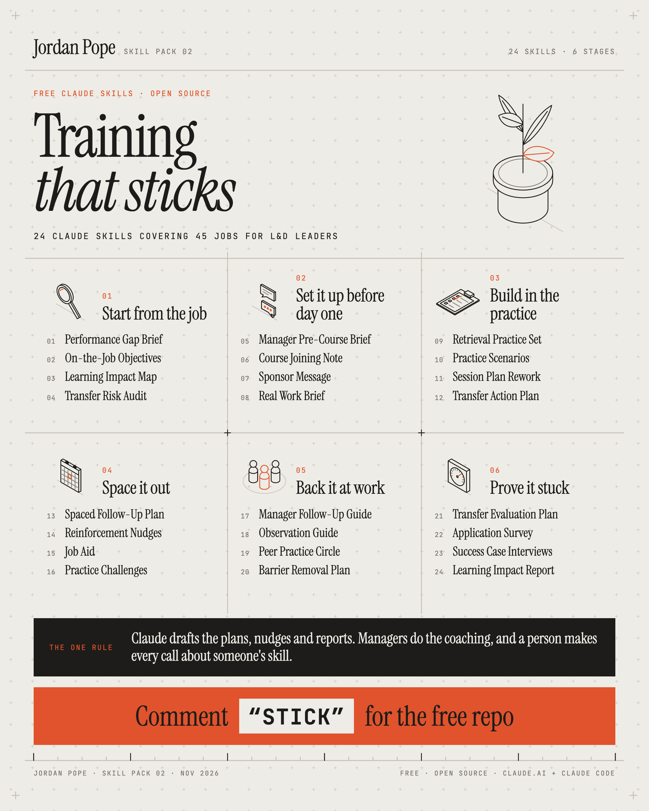

# Training that sticks: 24 free Claude skills for L&D leaders



For heads of L&D, L&D managers and L&D business partners in the UK. These skills skip the course
content and cover what happens around it, so they work on any programme you already run: a
management course, a systems rollout, a customer service course, mandatory safety training. They
draft the documents that decide whether people use what they learned: the conversation a manager
has with each learner before the course, the spaced follow-up for the 12 weeks after it, the
day-60 application survey and the impact report for your exec team. Most also check a draft you
already have. Free and open source.

**The one rule:** Claude drafts the plans, nudges and reports. Managers do the coaching, and a person makes every call about someone's skill.

## What's inside

24 skills in 6 stages, in the order the work happens: before the course, during it, the weeks
after, and the proof. Each skill drafts one document, and 21 of them also check one.

<!-- skills-table:start -->

### 01 · Start from the job

| # | Skill | What it produces | Upload file |
| --- | --- | --- | --- |
| 01 | [Performance Gap Brief](skills/performance-gap-brief/SKILL.md) | Turns a training request into the behaviour, the gap and its cause before a course is booked. | [performance-gap-brief.zip](dist/performance-gap-brief.zip) |
| 02 | [On-the-Job Objectives](skills/on-the-job-objectives/SKILL.md) | Rewrites course objectives as behaviours someone could watch happen at work. | [on-the-job-objectives.zip](dist/on-the-job-objectives.zip) |
| 03 | [Learning Impact Map](skills/learning-impact-map/SKILL.md) | Links each skill to a behaviour, a team result and a business goal on one page. | [learning-impact-map.zip](dist/learning-impact-map.zip) |
| 04 | [Transfer Risk Audit](skills/transfer-risk-audit/SKILL.md) | Checks a planned programme against what predicts transfer, and names the weak spots. | [transfer-risk-audit.zip](dist/transfer-risk-audit.zip) |

### 02 · Set it up before day one

| # | Skill | What it produces | Upload file |
| --- | --- | --- | --- |
| 05 | [Manager Pre-Course Brief](skills/manager-pre-course-brief/SKILL.md) | The talk a manager has with each learner before the course: why, what to try, when to review. | [manager-pre-course-brief.zip](dist/manager-pre-course-brief.zip) |
| 06 | [Course Joining Note](skills/course-joining-note/SKILL.md) | Joining instructions that set the expectation of using it at work, with the logistics. | [course-joining-note.zip](dist/course-joining-note.zip) |
| 07 | [Sponsor Message](skills/sponsor-message/SKILL.md) | A short note from a senior leader on why this matters and what should change. | [sponsor-message.zip](dist/sponsor-message.zip) |
| 08 | [Real Work Brief](skills/real-work-brief/SKILL.md) | Asks each learner to bring one live task to the course, with a template to fill in. | [real-work-brief.zip](dist/real-work-brief.zip) |

### 03 · Build in the practice

| # | Skill | What it produces | Upload file |
| --- | --- | --- | --- |
| 09 | [Retrieval Practice Set](skills/retrieval-practice-set/SKILL.md) | Questions that make people recall and apply, set for the course and the weeks after. | [retrieval-practice-set.zip](dist/retrieval-practice-set.zip) |
| 10 | [Practice Scenarios](skills/practice-scenarios/SKILL.md) | Work scenarios with decision points and feedback, at three levels of difficulty. | [practice-scenarios.zip](dist/practice-scenarios.zip) |
| 11 | [Session Plan Rework](skills/session-plan-rework/SKILL.md) | Checks a session plan for practice time and real-work links, then rewrites the weak parts. | [session-plan-rework.zip](dist/session-plan-rework.zip) |
| 12 | [Transfer Action Plan](skills/transfer-action-plan/SKILL.md) | If-then plans for when, where and how each learner will first use the skill. | [transfer-action-plan.zip](dist/transfer-action-plan.zip) |

### 04 · Space it out

| # | Skill | What it produces | Upload file |
| --- | --- | --- | --- |
| 13 | [Spaced Follow-Up Plan](skills/spaced-follow-up-plan/SKILL.md) | A dated schedule of recall and practice touchpoints for the 8 to 12 weeks after a course. | [spaced-follow-up-plan.zip](dist/spaced-follow-up-plan.zip) |
| 14 | [Reinforcement Nudges](skills/reinforcement-nudges/SKILL.md) | The emails or Teams messages for each touchpoint, each asking for one thing at work. | [reinforcement-nudges.zip](dist/reinforcement-nudges.zip) |
| 15 | [Job Aid](skills/job-aid/SKILL.md) | A one-page checklist or decision guide people use at the moment they need it. | [job-aid.zip](dist/job-aid.zip) |
| 16 | [Practice Challenges](skills/practice-challenges/SKILL.md) | Short weekly challenges that get the skill used on real work in the first month. | [practice-challenges.zip](dist/practice-challenges.zip) |

### 05 · Back it at work

| # | Skill | What it produces | Upload file |
| --- | --- | --- | --- |
| 17 | [Manager Follow-Up Guide](skills/manager-follow-up-guide/SKILL.md) | The questions a manager asks at day 7, 30 and 60, built on the GROW model. | [manager-follow-up-guide.zip](dist/manager-follow-up-guide.zip) |
| 18 | [Observation Guide](skills/observation-guide/SKILL.md) | What good looks like on the job, for a manager to watch for and give feedback on. | [observation-guide.zip](dist/observation-guide.zip) |
| 19 | [Peer Practice Circle](skills/peer-practice-circle/SKILL.md) | Agenda and prompts for a small group that meets to share what they tried and what stuck. | [peer-practice-circle.zip](dist/peer-practice-circle.zip) |
| 20 | [Barrier Removal Plan](skills/barrier-removal-plan/SKILL.md) | Finds what stops people using it at work, from time to targets, and who can fix each. | [barrier-removal-plan.zip](dist/barrier-removal-plan.zip) |

### 06 · Prove it stuck

| # | Skill | What it produces | Upload file |
| --- | --- | --- | --- |
| 21 | [Transfer Evaluation Plan](skills/transfer-evaluation-plan/SKILL.md) | What you'll measure, when and from which source, mapped to LTEM tiers or Kirkpatrick levels. | [transfer-evaluation-plan.zip](dist/transfer-evaluation-plan.zip) |
| 22 | [Application Survey](skills/application-survey/SKILL.md) | A 60-day survey on what people used, what got in the way and what changed. | [application-survey.zip](dist/application-survey.zip) |
| 23 | [Success Case Interviews](skills/success-case-interviews/SKILL.md) | Find who used it, what it changed and why others didn't, using Brinkerhoff's method. | [success-case-interviews.zip](dist/success-case-interviews.zip) |
| 24 | [Learning Impact Report](skills/learning-impact-report/SKILL.md) | A report for leaders on behaviour change and results, with the strength of evidence shown. | [learning-impact-report.zip](dist/learning-impact-report.zip) |
<!-- skills-table:end -->

## Install

### Claude.ai or the Claude desktop app (Pro, Max, Team or Enterprise plans)

1. In **Settings › Capabilities**, turn on **Code execution and file creation**. Skills need it.
2. Download **[`training-that-sticks-all-in-one.zip`](dist/training-that-sticks-all-in-one.zip)** for every skill in one upload, or pick single skills from the table above.
3. In **Settings › Capabilities › Skills**, choose **Upload skill** and pick the zip. Upload either the all-in-one zip or single skills; uploading both gives Claude two copies of each skill.
4. Start a new chat and ask for the document, for example: *"Write the pre-course brief for managers whose team leaders are going on our first-line manager programme next month."* Claude picks up the skill from your request.

Claude's settings get reorganised from time to time. If the menu names differ, search your settings for "Skills".

### Team and Enterprise admins

Upload the zips once in your organisation's settings under **Skills** and they appear for everyone in the workspace.

### Claude Code

```bash
git clone https://github.com/JordzPope/claude-skills-training-that-sticks.git
cp -R claude-skills-training-that-sticks/skills/* ~/.claude/skills/
```

Copy into a project's `.claude/skills/` folder instead to share them with everyone on that project.

## Try it on Hallowmere Facilities first

Every skill comes with sample input from Hallowmere Facilities, a 1,400-person facilities services firm with a Leeds contact centre and engineers across the North (fictional), with problems planted in it. Install a skill, open a new chat and say *"try it"*: Claude reads the sample, runs its checks and lists what it finds. Compare its list with [`sample-data/answer-key.md`](sample-data/answer-key.md) before any real data goes near it. More about the company and its five programmes in [`sample-data/README.md`](sample-data/README.md).

## What the skills are built on

The method inside the skills comes from the learning transfer research L&D teams already cite:
Baldwin and Ford's three factors (the learner, the design, the work environment), Broad and
Newstrom's finding that the manager's part before the training counts most, spaced retrieval,
if-then action plans, Brinkerhoff's impact map and Success Case Method, and Thalheimer's LTEM
alongside Kirkpatrick's levels. Nothing in the pack uses learning styles, and no skill quotes a
figure for "how much training fails".

## Using these with people data

- Check your organisation's AI policy before you add anything about a real person.
- Work with roles and initials. Survey answers, quiz scores and observation notes about a named person are personal data under UK GDPR: aggregate or anonymise them first.
- No skill scores, ranks or signs off a learner. For safety-critical or regulated training, competence sign-off stays with your qualified assessor under your own procedure.
- Every skill drafts. You read and correct the draft before it reaches a learner or a manager.
- References follow UK practice: UK GDPR and the Data Protection Act 2018 (ICO guidance), and the Equality Act 2010 for reasonable adjustments in training. Check the current versions. None of this is legal advice.

## Feedback

Found a skill that gets something wrong, or want one that isn't here? Open an issue on this repo or message me on [LinkedIn](https://www.linkedin.com/in/vaticanbusiness/).

## About

Made by [Jordan Pope](https://www.linkedin.com/in/vaticanbusiness/). Pack 02 in a free series of Claude skills for HR and L&D teams. Pack 01 is [for HR business partners](https://github.com/JordzPope/claude-skills-hr-business-partners).

Not affiliated with or endorsed by Anthropic. Claude is a trademark of Anthropic.

## Licence

[MIT](LICENSE). Use the skills, change them and share them.
